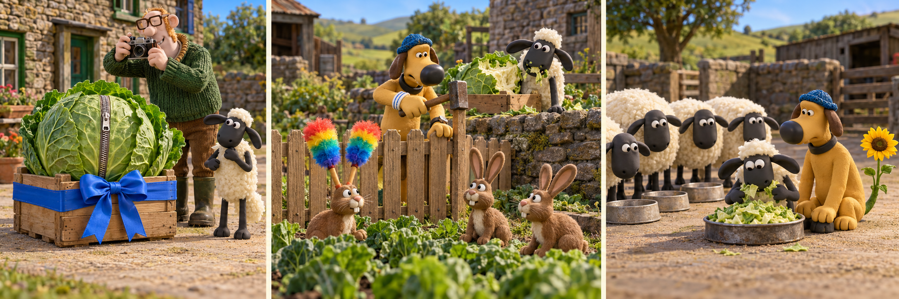

# Shaun the Sheep Movie：The Cabbage Behind the Wall

The Farmer had spent weeks growing a huge cabbage for the village show. On the morning of the competition, he placed it in a wooden box outside the farmhouse. A red ribbon was tied around the box. Shaun watched him proudly take photographs, then go inside for his coat. The cabbage certainly looked impressive, although Shaun thought it might taste even better.

While the Farmer was indoors, Shaun pulled off one small leaf. It was sweet and fresh. He took another, then another. By the time Bitzer appeared, one side of the cabbage was almost bare. Shaun quickly pushed the box behind a low wall. When Bitzer pointed at several rabbits near the vegetable garden, Shaun nodded. Bitzer ran towards them, and Shaun felt relieved.

However, the feeling did not last. Bitzer began putting up a wire fence between the rabbits and their usual feeding place. One young rabbit pressed its nose against the wire. Shaun looked away, but he could still hear the fence shaking. He had only wanted to avoid trouble. Now animals that had done nothing wrong were losing a place they needed.

Shaun could have stayed with the flock and allowed Bitzer to finish. Instead, he dragged the box out from behind the wall. He held a remaining leaf to his mouth and pointed at himself. Bitzer stared at him, then lowered his head. Shaun had expected an angry bark; that disappointed look was harder to face. He helped Bitzer take down the fence before the Farmer returned.

The Farmer examined the cabbage, sighed and put his coat away. There would be no prize that day. Later, he chopped the remaining cabbage and added it to the animals' supper. Shaun waited until the others had eaten before taking his share. Bitzer sat beside him, still quiet, but no longer turned away. Shaun was glad he had told the truth, although he wished he had done it before someone else had suffered.

## Useful B1 Words

- **bare**: without the things that usually cover something.
- **relieved**: pleased because something worrying seems to be over.
- **examine**: to look at something carefully.

## Reading Questions

1. What shows that the cabbage is important to the Farmer?
   - A. He brings it indoors to keep it safe.
   - B. He offers Shaun a leaf before leaving.
   - C. He records its appearance before the competition.
   - D. He asks Bitzer to grow another one.

2. Why does Shaun nod when Bitzer points at the rabbits?
   - A. He wants Bitzer to believe they caused the damage.
   - B. He hopes Bitzer will share the cabbage with them.
   - C. He wants Bitzer to move the box into their garden.
   - D. He believes they will help him hide the cabbage.

3. What makes Shaun feel differently about hiding his mistake?
   - A. He notices that the Farmer has returned early.
   - B. He finds that the other sheep know what happened.
   - C. He discovers that the cabbage cannot be eaten.
   - D. He sees innocent animals being affected by his behaviour.

4. What is hardest for Shaun when he shows Bitzer the box?
   - A. Bitzer refuses to help him move it.
   - B. Bitzer seems let down by his behaviour.
   - C. Bitzer makes a noise that attracts the Farmer.
   - D. Bitzer fails to understand what he is admitting.

5. Which description best fits Shaun's experience?
   - A. He discovers that growing food is harder than winning a prize.
   - B. He learns that friends will always keep his mistakes secret.
   - C. He accepts responsibility when avoiding blame hurts others.
   - D. He finds a way to win a competition after a poor start.

## Picture Hunt

There are two picture mistakes in each panel. Can you find all six?

