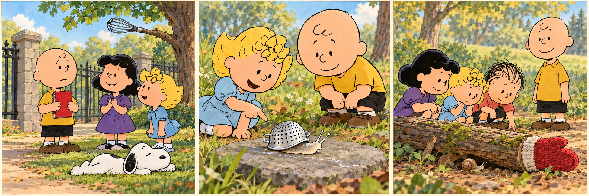

# The Peanuts Movie：The Saturday Walk

Charlie Brown had agreed to lead his friends on a Saturday nature walk. He had never led a group before, and he wanted everyone to remember a successful afternoon. On Friday evening, he drew a careful map and planned six stops. At each one, he would ask a question about a tree, a bird or a flower. He even prepared a small speech.

The next day, he waited beside the park gate with a green notebook. Lucy immediately asked how long the walk would take, while Snoopy lay down on the grass. Charlie Brown felt a little hurt. He had imagined everyone listening eagerly. Instead, they seemed more interested in their lunches. He began his speech anyway, speaking faster whenever someone looked away.

At the second stop, Sally noticed a tiny snail on a fallen leaf. Soon everyone was watching it, and Linus wondered where it was going. Charlie Brown glanced at his map. They were already ten minutes late. He nearly asked them to move on, but then Sally pointed out the silver trail behind the snail. He had walked past that spot many times without noticing one.

Charlie Brown closed his notebook and sat beside the others. He admitted that he knew very little about snails. To his surprise, nobody complained. Lucy suggested following the trail backwards, and Linus found another snail beneath a log. Charlie Brown asked questions too. For the first time that afternoon, he stopped wondering whether he looked like a good leader. He was too interested in what they might discover next.

They visited only three of his six stops. At the gate afterwards, Sally asked if he would lead another walk. Charlie Brown looked at the unused questions in his notebook, then added one about snails. His plan had helped him begin, but leaving it for a while had made the afternoon better. Next Saturday, he decided, there would be room for something he had not expected.

## Useful B1 Words

- **eagerly**: with great interest and excitement.
- **trail**: a line of marks left by something moving.
- **admit**: to say that something is true, although it may be difficult.

## Reading Questions

1. Why does Charlie Brown prepare so carefully for the walk?
   - A. He wants to teach his friends how to draw maps.
   - B. He hopes his first experience as a leader will go well.
   - C. He needs to find a shorter route through the park.
   - D. He wants to answer questions his friends have sent him.

2. How does Charlie Brown feel when his friends arrive?
   - A. Relieved that they have brought enough food.
   - B. Annoyed that they have reached the gate late.
   - C. Worried that they know more about nature than he does.
   - D. Disappointed that they show less interest than he expected.

3. What makes Charlie Brown hesitate before asking everyone to continue?
   - A. Sally helps him notice something new in a familiar place.
   - B. Linus reminds him that they have plenty of time left.
   - C. He realises that he has brought the wrong map.
   - D. He discovers that the next path is difficult to use.

4. What changes when Charlie Brown sits with his friends?
   - A. He becomes determined to finish every planned stop.
   - B. He decides to let Lucy organise all future walks.
   - C. He focuses on exploring rather than on his own performance.
   - D. He tries to hide how little he knows about nature.

5. What would Charlie Brown probably write about the afternoon?
   - A. “A leader should know the answers before inviting others along.”
   - B. “A good plan can leave space for discoveries made together.”
   - C. “Nature walks work best when everyone explores separately.”
   - D. “Finishing a route matters more than enjoying each stop.”

## Picture Hunt

There are two picture mistakes in each panel. Can you find all six?

