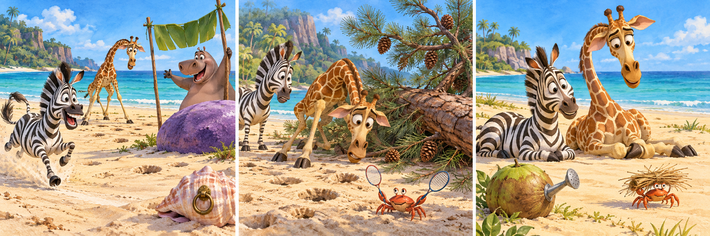

# Madagascar：The Race Nobody Won

Marty had found a long, smooth beach on Madagascar, perfect for a morning race. He invited Melman, certain the giraffe's long legs would make him a strong opponent. Melman glanced towards the trees and suggested watching instead. Marty laughed and promised that the winner could choose where they spent the afternoon. After several attempts to refuse politely, Melman finally agreed.

Gloria stood beside a large white stone to mark the finish. At her signal, Marty rushed forward, enjoying the cool air. He expected Melman to pass him easily. Instead, each time he looked back, the giraffe was further behind. Marty slowed down, wondering why his friend was making so little effort. Perhaps Melman simply disliked losing and wanted an excuse.

Near a fallen palm tree, Marty stopped completely. Melman was standing still, staring at a line of small holes in the sand. He explained that he was afraid of stepping on the crabs that lived underneath. Marty had noticed the holes earlier but had not considered them important. Now he could see that Melman's eyes were fixed on the ground, not on the finish.

Marty suggested moving closer to the sea, where the sand was clear. Melman shook his head. He had never wanted to race; he had agreed because Marty seemed so excited. Hearing this, Marty felt uncomfortable. He had mistaken a quiet refusal for a request to be persuaded. He offered to cancel the race, and this time he waited for an answer instead of arguing.

They walked back together, leaving Gloria surprised to see them arriving side by side. Melman suggested spending the afternoon watching the crabs from the shade. Marty almost reminded him that only the winner could choose. Then he smiled and agreed. For once, there was no result to announce. Later, as Melman pointed out a crab carrying a piece of dry grass, Marty realised that an afternoon chosen by someone else could still be an adventure.

## Useful B1 Words

- **opponent**: someone you compete against in a game or race.
- **refusal**: the act of saying that you will not do something.
- **persuade**: to make someone agree to do something by giving reasons.

## Reading Questions

1. Why does Marty think Melman will be a good person to race against?
   - A. Melman has already practised on the beach.
   - B. Melman usually enjoys choosing their activities.
   - C. Melman's height should give him an advantage.
   - D. Melman's suggestion makes him seem confident.

2. What does Marty first think when Melman falls behind?
   - A. Melman may be trying to avoid a proper defeat.
   - B. Melman may be saving his energy for the end.
   - C. Melman may have misunderstood Gloria's signal.
   - D. Melman may be waiting for him to slow down.

3. What does Marty discover near the fallen palm tree?
   - A. The race has disturbed the crabs' homes.
   - B. Melman cannot find the route to the finish.
   - C. The crabs have moved towards the finish stone.
   - D. Melman is concentrating on avoiding the crabs.

4. Why does Marty feel uncomfortable during their conversation?
   - A. He realises he chose a race he could easily win.
   - B. He understands that he pushed Melman into taking part.
   - C. He worries that Gloria will blame him for the delay.
   - D. He discovers that Melman doubts his ability to race.

5. What might Marty write about what happened?
   - A. “A competition is only enjoyable when the strongest person wins.”
   - B. “Friends should hide their worries so they can try new activities.”
   - C. “Listening to a friend's wishes can lead to an unexpected good time.”
   - D. “The fairest way to plan an afternoon is to let a race decide.”

## Picture Hunt

There are two picture mistakes in each panel. Can you find all six?

