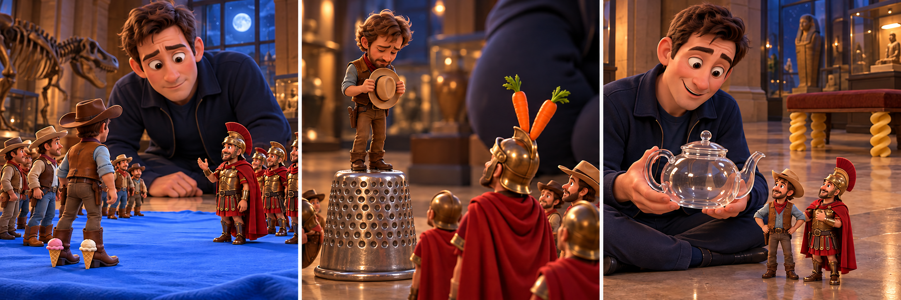

# Night at the Museum：The Midnight Rehearsal

Larry was making his rounds when he heard a sharp whistle near the miniature displays. Below him, Roman soldiers stood opposite a group of cowboys on a red cloth. Their leaders, Octavius and Jedediah, were waving their arms. Larry hurried over, expecting another argument. He had hoped for a peaceful shift, and separating two tiny armies was not his idea of one.

Before he could speak, Octavius raised a hand. The soldiers stepped aside, and Jedediah climbed onto a wooden box. He took off his hat, looked at Octavius and put it on again without saying anything. Then everyone returned to their starting places. Larry watched the whole sequence twice. If this was an argument, it was a surprisingly well organised one.

Octavius explained that his display would move upstairs the following day. The cowboys were preparing a farewell ceremony, but Jedediah kept forgetting his speech. Larry offered to write something for him. Jedediah refused. He could remember every word; the problem was saying them while Octavius was watching. Until that moment, Larry had not realised how much the move mattered to the cowboy.

Larry sat on the floor and asked what Jedediah actually wanted Octavius to know. After a long pause, the cowboy admitted that he would miss their evening conversations. He was also worried about crossing the enormous staircase to visit. Octavius looked surprised. He had thought Jedediah was pleased to have more space downstairs. The two began discussing visits, forgetting the waiting soldiers and the unfinished ceremony.

Larry left them talking and returned later with a small covered basket. With their permission, he would carry them between floors on his rounds. Jedediah still made his speech before dawn, although it was shorter than planned. Larry listened from a bench. He had arrived ready to stop a quarrel, but the two friends had needed a chance to explain what neither had been willing to say.

## Useful B1 Words

- **sequence**: a series of things happening in a particular order.
- **ceremony**: a formal event held for a special reason.
- **farewell**: a goodbye to someone who is leaving.

## Reading Questions

1. How does Larry feel when he first sees the soldiers and cowboys?
   - A. Amused by the small size of their meeting place.
   - B. Excited about watching their evening entertainment.
   - C. Worried that they will wake the museum's visitors.
   - D. Annoyed that he may have to deal with a disagreement.

2. What makes Larry begin to question his first impression?
   - A. The two leaders ask him to join their discussion.
   - B. The groups repeat the same actions in an orderly way.
   - C. The soldiers leave before he can reach the display.
   - D. The cowboys hide their equipment when he approaches.

3. Why does Jedediah refuse Larry's offer to write a speech?
   - A. He needs help expressing his feelings, not remembering words.
   - B. He has decided that the ceremony should take place upstairs.
   - C. He wants Octavius to make a speech instead of him.
   - D. He thinks Larry knows too little about Roman history.

4. What does Octavius learn during the conversation on the floor?
   - A. Jedediah wants the Roman soldiers to remain downstairs.
   - B. Jedediah has already found a safe route up the staircase.
   - C. Jedediah feels differently about the move than he had assumed.
   - D. Jedediah would prefer to hold a much larger ceremony.

5. Which description best sums up Larry's role in the story?
   - A. He settles a competition by giving both groups equal space.
   - B. He helps two friends discuss their worries and stay in touch.
   - C. He persuades a nervous speaker to use someone else's words.
   - D. He prevents a farewell by arranging for a display to stay.

## Picture Hunt

There are two picture mistakes in each panel. Can you find all six?

