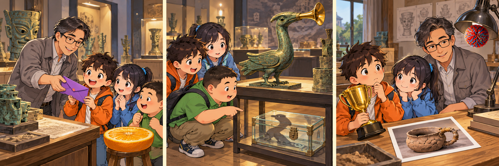

# 大中华寻宝记：The Treasure That Stayed Behind

Mike, known to his friends as Mi Ke, was visiting a museum near Sanxingdui with Guoguo and Yueban. Their teacher, Dr Qin, had arranged a treasure hunt in the activity room after their tour. Each team received a yellow envelope containing a drawing of a bird and three clues. Mike immediately imagined discovering something valuable. He hoped his team would finish before everyone else.

The drawing led them to a table covered with copies of old objects. Guoguo compared the bird's curved beak with one on a bronze model. Yueban noticed a pattern beneath its feet. Mike reached for the model, expecting to find the next clue underneath. However, an assistant asked him to leave it where it was. Everything they needed could be found by looking carefully.

Mike stepped back, annoyed that the hunt seemed to have so many rules. Then Yueban crouched beside the table. From that angle, the bird's shadow pointed towards a small wooden chest on a lower shelf. Inside was a photograph of an old cooking pot, together with a note asking which object they would save if they could choose only one.

Mike chose the bird because it looked impressive. Guoguo preferred the pot, which might reveal how ordinary people had prepared meals. Mike almost dismissed her answer, but Dr Qin asked what a beautiful object could tell them without its history. Looking at the photograph again, Mike noticed a repaired handle. Someone had cared enough about that simple pot to keep using it. Suddenly, he wanted to know who that person had been.

Their team finished second. The prize was a postcard, not an ancient treasure, and every object stayed in the room. Yet Mike no longer felt disappointed. On the back of his postcard, he wrote a question about the repaired pot. He had arrived hoping to carry something away. Instead, he left with a reason to return and look more closely at what people usually passed by.

## Useful B1 Words

- **clue**: a piece of information that helps you solve a problem.
- **dismiss**: to decide that an idea is not worth considering.
- **reveal**: to show something that was not known before.

## Reading Questions

1. What does Mike particularly want at the start of the activity?
   - A. To make a drawing that can be displayed in the museum.
   - B. To complete the hunt more quickly than the other teams.
   - C. To help Dr Qin prepare clues for younger visitors.
   - D. To learn how the museum makes copies of objects.

2. What does the assistant's instruction suggest about the hunt?
   - A. The bronze model has been put on the wrong table.
   - B. The next clue will be given out after the tour.
   - C. The children should ask other teams for information.
   - D. The children can find the answer without moving the objects.

3. How does Yueban help the team make progress?
   - A. He notices something useful by changing his position.
   - B. He recognises the person who made the wooden chest.
   - C. He remembers seeing the cooking pot during the tour.
   - D. He discovers a note hidden beneath the bronze model.

4. Why does Mike become interested in the cooking pot?
   - A. He learns that it is more valuable than the bird.
   - B. He hopes to repair it with Guoguo's help.
   - C. He begins to imagine the life of someone who used it.
   - D. He realises that choosing it will win the competition.

5. Which comment best describes Mike's experience?
   - A. “Winning a museum competition requires choosing the oldest object.”
   - B. “An ordinary object can become a treasure when we ask about its story.”
   - C. “Copies of historical objects are more interesting than the real things.”
   - D. “The best museum visit ends with a valuable object to take home.”

## Picture Hunt

There are two picture mistakes in each panel. Can you find all six?

