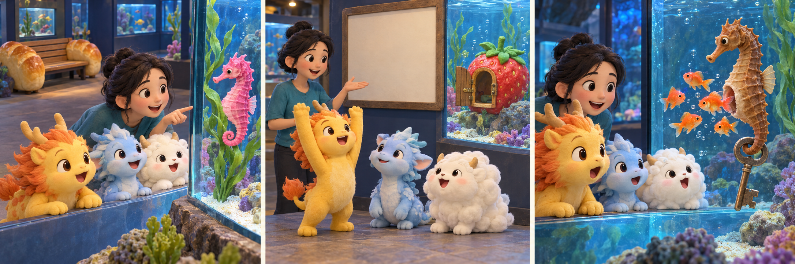

# 神兽发电站：Dingguagua and the Unexpected Father

Dingguagua was looking forward to a quiet aquarium visit with two other mythical beasts. At the seahorse tank, a keeper announced that one of the animals would soon release its babies. Dingguagua hurried to the front. He loved being the first to discover something unusual, and he promised his friends that he would explain everything. After all, how difficult could watching a fish be?

A brown seahorse held onto a plant with its tail. Its rounded belly looked like a little bag. Dingguagua confidently called it the mother, but the keeper shook her head. This was the father. In seahorses, she explained, the female places her eggs inside a special pouch on the male's body. He carries them while the babies develop. Dingguagua laughed, expecting her to admit she was joking.

The keeper pointed towards an information board, but Dingguagua folded his arms. Perhaps someone had put the wrong board beside the tank. He had already given his friends an explanation and did not want to look foolish. One friend suggested staying to watch rather than deciding who was right. Dingguagua agreed, although he moved away from the front and became unusually quiet.

After a while, the male began bending his body, and tiny seahorses came out of his pouch. They drifted into the water, each looking like a much smaller seahorse. Dingguagua leaned forward, forgetting his embarrassment. The keeper explained that the young would have to find food for themselves. Their father had protected them while they developed, but he would not lead them around the tank like a parent duck.

Before leaving, Dingguagua asked how the keeper cared for such tiny animals. His friends gathered beside him as she answered. On the journey home, he described the father seahorse again, correcting his earlier mistake without being asked. He had wanted to impress everyone by knowing the answer immediately. Now he had a better story to tell because he had stayed long enough to change his mind.

## Useful B1 Words

- **pouch**: a small bag or a pocket shaped like one.
- **confidently**: in a way that shows you feel sure about something.
- **embarrassment**: the uncomfortable feeling of looking foolish in front of others.

## Reading Questions

1. Why does Dingguagua promise to explain what happens?
   - A. He wants to show his friends how much he knows.
   - B. The keeper has asked him to lead their visit.
   - C. His friends are too nervous to approach the tank.
   - D. He has watched the same event on an earlier visit.

2. How does Dingguagua first react to the keeper's explanation?
   - A. He worries that the seahorse may be unwell.
   - B. He asks his friends to help him read the board.
   - C. He thinks she is trying to make them laugh.
   - D. He wishes he had arrived at the tank earlier.

3. Why does Dingguagua question the information board?
   - A. He finds that it describes a different kind of fish.
   - B. He is reluctant to accept that his own explanation was wrong.
   - C. He notices that it gives less detail than the keeper.
   - D. He believes the keeper has asked him to check it.

4. What does Dingguagua learn when the babies appear?
   - A. The keeper will return them to the father's pouch.
   - B. They will stay beside their father while he finds food.
   - C. They will develop their seahorse shape later.
   - D. Their father's protection does not continue in the way he expected.

5. Which description best sums up Dingguagua's visit?
   - A. He discovers that studying alone is better than asking questions.
   - B. He proves that visitors can sometimes correct an expert's mistakes.
   - C. He learns more by accepting evidence and admitting a mistake.
   - D. He finds that being first matters more than understanding an event.

## Picture Hunt

There are two picture mistakes in each panel. Can you find all six?

