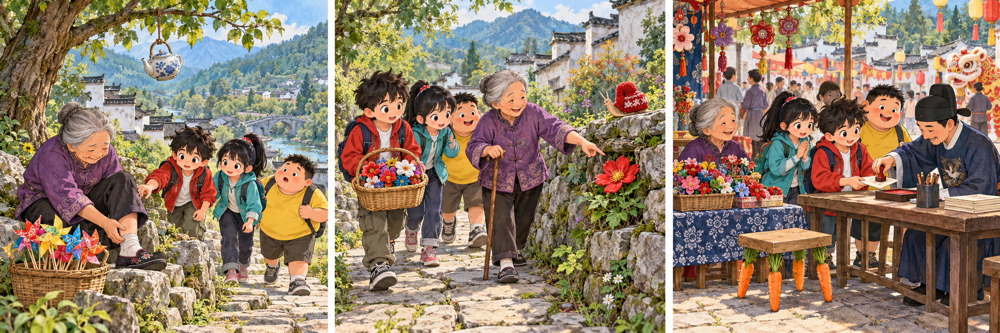

# 大中华寻宝记：The Last Walker

Mi Ke was studying a map when Dr Qin announced a walking challenge on an old path in Anhui. Each team had to collect three stamps before reaching a village square. Mi Ke wanted to arrive first. He had been slow during their last adventure, and he hoped this walk would show Guoguo and Yueban that they could depend on him.

At the first stop, an elderly woman was resting beside a stone wall. A basket of cloth flowers stood at her feet. She asked whether they were going to the square, where she planned to sell her flowers at a village festival. Mi Ke pointed to the path ahead, but Guoguo noticed that the woman was rubbing her ankle.

The woman said she could walk, although she needed to move slowly. Mi Ke looked at the other teams disappearing round a corner. He offered to carry her basket, expecting this to make her faster. It did not. Soon he was several steps ahead of everyone. When he turned back, the woman was showing Yueban a tiny blue flower growing between two stones.

Mi Ke nearly asked them to hurry. Then he heard the woman explain that she had walked this path to school as a child. The cloth flowers copied plants she remembered from those journeys. He returned to her side and asked about a yellow one. As they walked, she told them about summer rain, winter mornings and a friend who had always waited for her.

They reached the square after the final stamp table had closed. Mi Ke felt a brief disappointment, but helped arrange the flowers anyway. Guoguo asked him to describe their walk to a visitor. This time, he had much more to say than how quickly they had travelled. Later, Dr Qin asked whether he had proved himself. Mi Ke watched the woman greeting customers and smiled. He no longer needed a finishing time to answer that question.

## Useful B1 Words

- **depend on**: to trust someone to help or do what is needed.
- **arrange**: to put things in a particular order or position.
- **disappointment**: sadness because something is not as good as you hoped.

## Reading Questions

1. Why is the walking challenge especially important to Mi Ke?
   - A. He wants to improve his knowledge of local plants.
   - B. He wants his friends to see him as a reliable teammate.
   - C. He hopes to win a gift for Dr Qin.
   - D. He hopes to find a shorter route than the map shows.

2. What does Mi Ke expect when he offers to carry the basket?
   - A. The woman will let him keep a flower.
   - B. His friends will continue without him.
   - C. The woman will decide to return home.
   - D. The group will be able to walk more quickly.

3. Why does Mi Ke return to the woman's side?
   - A. He becomes interested in what the path means to her.
   - B. He needs her help to find the next stamp table.
   - C. He realises that he has taken the wrong basket.
   - D. He wants to explain why the team must hurry.

4. What does Mi Ke's reaction at the square suggest?
   - A. He thinks Dr Qin should extend the challenge.
   - B. He wishes he had left the woman behind.
   - C. He values what they gained despite finishing late.
   - D. He believes the visitors will blame him for the delay.

5. Which statement best expresses the message of the story?
   - A. Learning a route well is the best way to win a challenge.
   - B. A journey can matter for more than reaching the finish first.
   - C. People should avoid competitions when travelling with friends.
   - D. Old memories are more useful than modern maps.

## Picture Hunt

There are two picture mistakes in each panel. Can you find all six?

