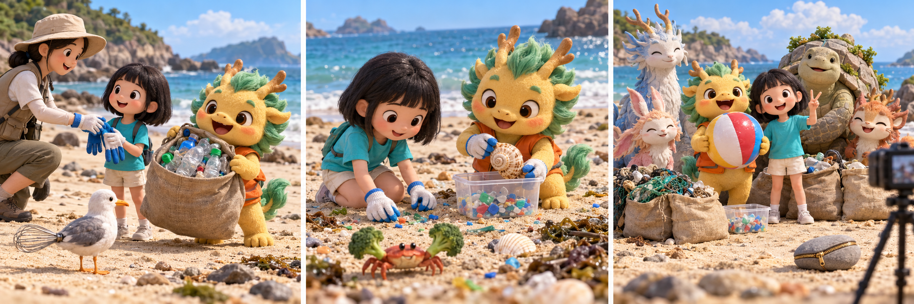

# 神兽发电站：The Smallest Collection

Dingguagua arrived at a beach cleanup with a large empty sack and an ambitious plan. By lunchtime, he wanted to collect more rubbish than any other mythical beast. He imagined everyone admiring a huge pile of bottles beside him. The organiser gave each volunteer gloves and explained that they should leave shells, seaweed and living creatures where they found them.

At first, Dingguagua's plan went well. He filled half his sack with plastic bottles near the picnic area. Then he noticed a young volunteer sitting on the sand with a small container. She was carefully picking up bright pieces that were hardly bigger than buttons. Her container looked almost empty. He wondered why she had chosen such a slow way to help.

The girl showed him a handful of broken plastic. Waves and sunlight could break larger objects into smaller pieces, she explained. Some animals might mistake these pieces for food. Dingguagua looked down. What he had thought were colourful stones included bits of bottle tops and wrappers. His sack suddenly seemed less impressive, although the bottles inside still needed removing.

He knelt beside her and began looking more closely. The work required patience, and nobody passing along the beach stopped to admire it. Once, he reached for a pale object, then realised it was a shell and left it alone. The girl smiled. They worked together until the organiser called everyone back. Dingguagua's sack had hardly grown heavier, but their little container was nearly full.

During the final photograph, another beast offered Dingguagua a place beside the largest pile of rubbish. He asked the girl to join them with the container. It was almost hidden behind the sacks, so he held it up where it could be seen. He still enjoyed being in the photograph, but now he wanted people to notice her careful work too. When the organiser asked who would return next month, Dingguagua raised his hand before anyone mentioned a competition.

## Useful B1 Words

- **ambitious**: wanting to achieve something difficult or impressive.
- **patience**: the ability to keep working or waiting calmly.
- **impressive**: making people admire something.

## Reading Questions

1. What does Dingguagua hope to achieve at the beginning?
   - A. To make a new friend among the volunteers.
   - B. To discover unusual objects from the sea.
   - C. To gain attention by collecting the most rubbish.
   - D. To learn how the organiser runs the event.

2. What is Dingguagua's first opinion of the girl's work?
   - A. It seems unlikely to achieve very much.
   - B. It looks more enjoyable than carrying bottles.
   - C. It seems too difficult for a young volunteer.
   - D. It looks like a useful way to collect shells.

3. What does Dingguagua realise after talking to the girl?
   - A. The bottles he collected can safely stay on the beach.
   - B. Most of the bright objects are natural stones.
   - C. Small plastic pieces are only found near picnic areas.
   - D. Rubbish he had overlooked also deserves attention.

4. Why does Dingguagua hold up the small container for the photograph?
   - A. He wants to hide how little his sack contains.
   - B. He wants the girl's contribution to be recognised.
   - C. He wants the organiser to count its contents.
   - D. He wants to prove that they collected the heaviest load.

5. Which description best sums up Dingguagua's experience?
   - A. He learns that working alone produces better results.
   - B. He discovers that beach cleaning is mainly a competition.
   - C. He moves from wanting praise to appreciating less visible help.
   - D. He gives up a difficult task and finds an easier one.

## Picture Hunt

There are two picture mistakes in each panel. Can you find all six?

